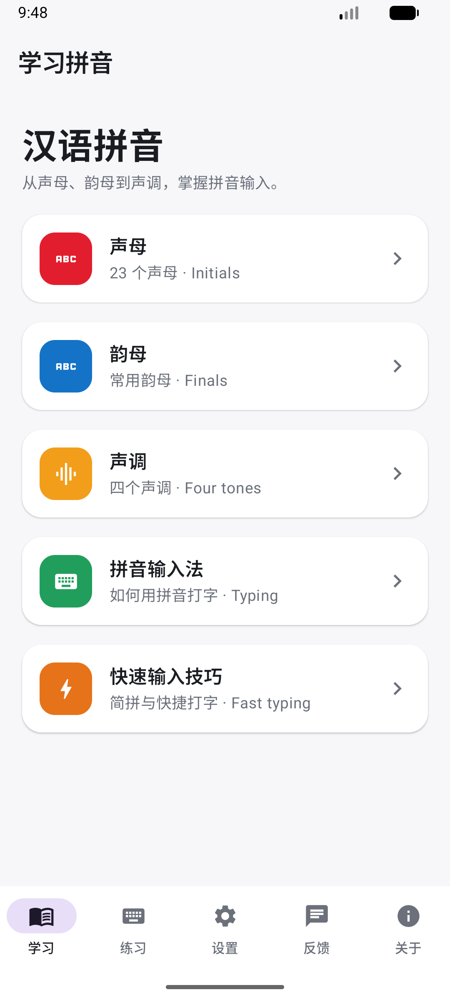

# 汉语拼音 · Hanyu Pinyin (Android)

A native Android app for learning **Hanyu Pinyin** (Chinese romanization) and practicing fast
**pinyin input** — the way you actually type Chinese on a keyboard. This is the Android twin of
the [iOS app](https://apps.apple.com/us/app/%E6%B1%89%E8%AF%AD%E6%8B%BC%E9%9F%B3-hanyu-pinyin/id6782562028),
with the same features, data, and China-red white theme.




## Features

- **学习 (Learn)** — the building blocks of pinyin, each with example characters and **tap-to-hear
  pronunciation**:
  - 声母 (23 initials), 韵母 (finals), 声调 (the four tones), how a 拼音输入法 works, and a
    快速输入技巧 (fast-typing tips) lesson.
- **练习 (Practice)** — typing sessions that show Chinese and ask you to type the pinyin
  (no tone marks needed, just like a real IME), with live feedback and **accuracy + 字/分钟** scoring:
  - 汉字 (characters), 词语 (words), 声母, 韵母, 长句 (sentences), 综合 (mixed).
  - **简拼速打** — a first-letter **shortcut drill** (type `wan` for 我爱你) for efficient input.
  - **长信息练习** — **long-message** drill (whole sentence or 简拼) for sustained fast typing.
  - **ü → v 练习** — the keyboard technique of typing **ü as `v`** (绿 → `lv`, 律师 → `lvshi`).
  - **限时挑战** — a **60-second speed challenge** with a live countdown and auto-advance.
- **设置 (Settings)** — choose a **female (女声) or male (男声)** Chinese voice for pronunciation.
- **反馈 (Feedback)** — send feedback straight to the team via WhatsApp.
- **关于 (About)** — app info, developer, and version.

Pronunciation uses Android's on-device `TextToSpeech` (offline once a Chinese voice is
installed). White theme, Simplified-Chinese interface, phone, portrait.

## Tech stack

| Layer | Choice |
|-------|--------|
| UI | Jetpack Compose (Material 3, `NavigationBar`) |
| Language | Kotlin 2.0 |
| Min SDK | 26 (Android 8.0) · target 36 |
| Speech | `android.speech.tts.TextToSpeech` (zh-CN) |
| Theme | Single `ui/Theme.kt` token file (`Brand`) |

## Project structure

```
app/src/main/java/com/tertiaryinfotech/hanyupinyin/
  MainActivity.kt              app entry (edge-to-edge, TTS lifecycle)
  ui/RootScreen.kt             bottom nav (学习 / 练习 / 设置 / 反馈 / 关于) + in-tab navigation
  ui/Theme.kt                  white-theme Brand tokens + Material 3 light scheme
  ui/Components.kt             AppCard / IconBadge / NavCard building blocks
  ui/LearnScreen.kt            learn home, initials/finals grid, tones, IME lesson, fast-typing tips
  ui/PracticeScreen.kt         practice home (session catalog)
  ui/PracticeSessionScreen.kt  typing flow, timed challenge, scoring, results
  ui/SettingsScreen.kt         voice (female/male) selection + test playback
  ui/FeedbackScreen.kt         WhatsApp feedback form
  ui/AboutScreen.kt            developer + version
  data/PinyinData.kt           initials, finals, tones, characters, words, sentences
  data/PracticeCatalog.kt      the 10 practice session definitions
  speech/Speaker.kt            TextToSpeech wrapper (female/male zh voice)
play-assets/                   Play Store listing assets (icon, feature graphic, screenshots)
```

## Build & run

```bash
export JAVA_HOME="/Applications/Android Studio.app/Contents/jbr/Contents/Home"
export ANDROID_HOME="$HOME/Library/Android/sdk"
./gradlew :app:assembleDebug          # debug APK
./gradlew :app:bundleRelease          # signed AAB (needs keystore.properties, not in git)
```

Install on a device/emulator:

```bash
adb install -r app/build/outputs/apk/debug/app-debug.apk
```

> Release signing reads `keystore.properties` + `keystore/upload-keystore.jks`, both
> gitignored — see `CHANGELOG.md` for release history.

## The 10 practice drills

| Drill | What it trains |
|-------|----------------|
| 汉字练习 | Single characters → pinyin |
| 词语练习 | Common words → pinyin |
| 声母练习 / 韵母练习 | Initials & finals recognition |
| 长句练习 | Whole-sentence fast typing (简拼 accepted) |
| 简拼速打 | First-letter shortcuts only |
| 长信息练习 | Long messages for sustained speed |
| ü → v 练习 | Typing ü as `v` (nv, lv, lvshi…) |
| 限时挑战 | 60-second speed challenge, auto-advance |
| 综合练习 | Mixed characters + words |

## Developer

**Tertiary Infotech Academy Pte. Ltd.** — [tertiaryinfotech.com](https://www.tertiaryinfotech.com)

## Acknowledgements

- Inspired by [pinyinput.com](https://www.pinyinput.com/)
- Built with [Jetpack Compose](https://developer.android.com/jetpack/compose) and
  [Material Design 3](https://m3.material.io/)
